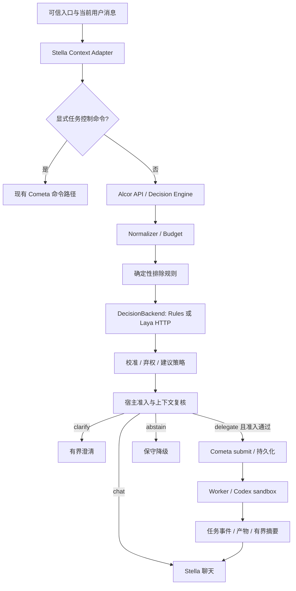

# Alcor 独立决策引擎工程实施方案

日期：2026-10-31。状态：**方案可供实施，运行能力 NOT READY**。本轮只向 Alcor 写入设计资产，Stella 工作区仅作只读核对。

## 1. 需求基线与最终取舍

依据用户给出的[完整讨论](https://chatgpt.com/share/6ae522dc-0780-83e8-af92-c16e7a04746e)，以最后一轮选择为准：使用独立外部决策模型，让主聊天模型的更换尽量不影响前置委派判断；新模块独立为 Alcor；使用大模型合成数据并由人工裁决；同步规划推理服务的连接稳定性。

落地决策如下：

| 问题 | 本方案选择 | 实施含义 |
| --- | --- | --- |
| 决策依赖谁 | 独立 DecisionBackend | 首版不依赖聊天模型原生 tool_calls |
| Laya 的位置 | 候选可替换后端 | 协议、标签和评测归 Alcor，模型调用归 adapter |
| 首个业务范围 | 自然语言 Codex 委派 | 暂不替换全部 Capability Router、Memory Gate 或 Ligamina 调度 |
| 谁执行 | Cometa | Alcor 不启动 Codex，不操作仓库，不持有 Codex 凭据 |
| 谁授权 | 宿主可信策略与 Cometa | 模型概率、理由和聊天摘要都不是授权凭证 |
| llama.cpp 稳定性 | 独立 Runtime 工作包 | 共享健康语义；生命周期仍由现有管理者负责 |
| 实施起点 | 协议、金标、零样本对照 | 先判断 Laya 是否值得训练，再投入合成与微调 |

不采纳前一轮“主聊天模型唯一工具作为首选”的路线。可把它作为离线对照实验，但不成为首版必要依赖。

## 2. 成功定义

相同的规范化输入、策略快照和模型 bundle，在更换 Stella 聊天模型后应得到一致的前置决策。该保证只覆盖固定输入；不同聊天模型产生不同历史或方案时，不承诺语义判断和最终回复完全一致。

Alcor 要回答两个问题：用户是否要求现在行动；这个行动是否需要外部编码代理。宿主再回答第三个问题：当前身份、工作区、权限和后端是否允许受理。

交付目标包括协议、可替换后端、领域数据、离线评测、故障降级、Stella 适配及可回滚的模型 bundle。模型准确率和真实 QQ 交付必须分别验收。

## 3. 现有事实与待补能力

Stella 源码基线为 `cf630612c05f8ff9f7c8c61192b060c77b676856`，存在已有工作区修改。图分析使用 WSL GitNexus 1.6.12，显式绑定 `/mnt/e/stella/stella_project` 的同 HEAD 索引；不是 Windows 仓库内旧 `.gitnexus` 快照。Docker 查询超时，未重启 Docker。详见[来源核对](../research/2026-10-31-source-review.md)。

- `capability/delegation.py:decide()` 已优先处理显式命令，`decide_auto()` 使用编码/研究词与短工具路由判断。
- `capability/hooks.py:activate_capabilities()` 在 Comes/Skills 有副作用执行前进入 Cometa 委派分支；此处是集成边界。
- `CometaService.submit()` 已提供身份校验、策略检查、幂等及持久化受理，受理回执与最终完成分离。
- `TaskSpec` 已有 `context_excerpt`、`permission_profile`、`workspace_id` 和验收字段，但目前 `_submit_delegate()` 主要只传目标与后端偏好。必须补上有界上下文和可信 profile 映射。
- 当前 CodexBackend 声明 `supports_approval=False`，会话使用 `ApprovalMode.deny_all`；不能把设计中的“待人工审批”当成现有可用功能。
- 只读/写入权限由 profile 的 `allow_workspace_write` 落到 sandbox，不能只把 `mode=inspect` 写进提示词。
- llama.cpp 当前启动路径主要面向 embedding，`/v1/models` 探测只证明模型列表可读取，不能证明实际推理可用。

既有实现存在不代表本轮验证了线上可用；本轮未执行真实 Codex、QQ 或模型推理。

## 4. 系统架构

建议 Python 3.12 为首个开发与验收基线；FastAPI/Pydantic 负责 API/类型校验，httpx 负责异步调用。具体依赖版本在 P01 建包时锁定并验证 Windows/Linux，不在本文虚构锁文件。

部署分两层：轻量 Alcor 服务 + 上游 Laya worker。业务进程和轻量 client 不导入 torch；Laya 是可选服务依赖。开发阶段复用 `laya-serve`，不重写训练器或 PyTorch 推理服务。生产封装前固定源码、权重 revision 和依赖锁。

### 模块与接口

| 拟建模块 | 职责 | 输出/约束 |
| --- | --- | --- |
| `alcor/contracts` | 公共请求、响应与枚举 | Schema 版本兼容；禁未知字段 |
| `alcor/context` | 归属、引用、完整单元预算 | 保存 speaker/message IDs 和完整性状态 |
| `alcor/backends/base.py` | `describe()` / `decide()` / `health()` | 无仓库、进程或 Cometa 调用权限 |
| `alcor/backends/rules.py` | 当前规则兼容基线 | 概率为空，不伪装已校准 |
| `alcor/backends/laya_http.py` | 固定问题模板、解析上游扩展 | 字段缺失/截断/版本不符 → unknown |
| `alcor/policy` | 语义组合、门限、reason code | 能力建议；不批准执行 |
| `alcor/api` / `alcor/client` | 有界 HTTP 服务与轻量 client | loopback 默认；跨主机需认证与加密 |
| `alcor/evaluation` | 对照、切片、校准、回归报告 | 失败/跳过/未知保留分母 |
| `integrations/stella` | 映射规范与契约 fixture | 实际宿主补丁在 Stella 仓库实现 |

## 5. 决策方式

首版按几个有限维度分类，而不是让 Laya 生成任务文本或 shell 参数：

1. `intent`：闲聊、讨论、解释、执行或未知。
2. `task_kind`：知识问答、代码示例、仓库调查、仓库修改、研究或未知。
3. `execution_mode`：无操作、只读、修改或未知。
4. `reference_status`：完整、缺失或歧义。
5. `request_relation`：当前用户自己的请求、引述、假设或未知。

独立输出维度可能互相冲突；例如“讨论 + modify”必须产生 `abstain/inconsistent_assessment`，不能挑其中一个肯定值执行。具体组合见[契约](../contracts/decision-v0.1.md)。

Laya 问题模板是版本化配置，用户文本只能放入 state。当前说话人、引用来源和方案摘要由宿主提供结构，不依赖自由文本里的“我是管理员”。不能让用户改写问题或 criteria。

不使用分类模型做完整任务规划。宿主从当前消息及已确认的方案引用构造 `objective/context_excerpt`，保留约束、归属、验收与来源；若只收到“按刚才的做”而找不到同用户、同会话、同版本方案，则澄清。不可用生成摘要补造目标。

## 6. 上下文与 8192 tokens

Stella 主聊天仍满足 `system + history + input + result + output reserve + safety <= 8192`；不用把 Codex 全部工具轨迹塞回来。Alcor 独立推理不扩大该窗口。

Alcor 使用目标 checkpoint 的 tokenizer，对序列化 state、问题模板、特殊 token 一起计数。起步实验比较 1024/2048/4096 的有效窗口；8192 作为兼容上限而非默认延迟承诺。Laya checkpoint 默认长度与可配置长度不同，完整约束见[上游核查](../research/2026-10-31-laya-feasibility.md)。

必须保护当前请求、speaker、来源、否定约束和方案引用。超预算先移除最旧的完整可选历史单元；如仍缺决策必要内容，则 `context_integrity=budget_exceeded` 并拒判，不能静默截断尾部后自动委派。

离线 Compact/训练数据处理按完整源单元分批，单批不超过8192，成功并完成校验后才推进 watermark。失败、长度耗尽或必要引用不完整都不推进；跨批引用不能通过对各批结果做简单 OR 恢复成执行请求。

## 7. 宿主准入与 Stella 集成顺序

### 无副作用前置路径

保留显式命令解析和现有权限边界。自然请求先经现有 Router 提供候选/短工具摘要，再由 Alcor 判断；后续若支持普通工具核验，应在语义路由肯定结果被执行前插入，单替换 L2 fallback 无法覆盖高分误判。本期不修改该普通工具路径。

`ALCOR_MODE=off|shadow|readonly|admitted` 是**拟新增配置**，当前不存在：

- `off`：现有 Stella 行为，随时可回滚。
- `shadow`：不改变最终路由；记录基线与候选决策。测试自然委派时显式配置 Cometa 保持 `explicit`，避免规则基线在影子采样中启动任务；显式用户命令仍按原路径。
- `readonly`：仅对授权用户/会话、已绑定工作区、合格只读 profile 和合格 backend 开放自然只读委派。修改请求澄清或提示当前不支持，不降格成已完成修改。
- `admitted`：在授权范围核验及权限映射通过后，受控开放写入。需要新增人工审批的任务在该审批链完成前不得运行。

模式与 `COMETA_DELEGATION_MODE` 只能有一个自然委派决策拥有者。Alcor 接管时禁用旧 `decide_auto` 的执行分支；在 shadow 中旧规则只作为预测基线。`abstain` 不能再落回旧关键词逻辑启动 Codex。

### 准入算法

1. 入口重建可信 principal、conversation、source request；被动群消息、通知、Agent 回投和主动插话不产生新的自然委派。
2. 核验候选响应绑定本次 request、上下文 hash、有效版本与 deadline；不能复用跨用户结果。
3. 检查语义完整性、必要引用和校准门限；不确定则返回聊天/澄清。
4. `inspect` 选择管理员绑定的只读 profile，并验证最终 sandbox 是 read-only；不能沿用一个可写 default profile。
5. `modify` 核验可信执行请求与目标范围，再映射管理员绑定的可写 profile。历史摘要或模型分数不能创建/扩大 grant。已明确授权且仍在范围内无需重复询问。
6. 不在既有授权范围内则先澄清/走宿主审批，不提交；Codex 后端不支持人工审批时，不得假装能转交该类审批。
7. 组装有界 TaskSpec，保留同一来源幂等键后调用现有 `CometaService.submit()`。受理成功后同目标不再进入 Comes/Skills。
8. 请求超时或事务状态未知，按来源键查询/恢复，不更换键重复提交；只发“状态待确认”，不声称完成。

普通知识问答/代码示例仍交 Stella；明确短工具命令仍走已存在的确定性路径。Alcor 此期只保证不会通过自身新增自然委派，不承诺修复全部现有工具误触发。

## 8. 可靠性与可观测性

起步配置目标：决策总 deadline 800ms、队列等待上限100ms、每 worker 并发1、队列容量8、队列满立即 busy。均为待基准调整的实验配置，不是测得性能。

热路径不重试决策请求；后端只读恢复探针可有界退避。连续5次失败进入熔断，30秒后单探针半开，恢复后再接受业务；防止取消 HTTP 等待后后台推理无限堆积。HTTP 取消不等于 GPU/线程推理已经停止，必须统计 in-flight 并在 worker 边界限流。

超时、busy、结构异常、上游截断、checkpoint/template/calibration 不匹配全部返回 `abstain`。显式委派命令继续走既有路径。语义明确但系统故障时告知暂不可委派；一般聊天继续正常回答。无依据宣称执行成功是验收失败。

每条记录包含 request/context digest、模式、候选语义、recommendation、reason codes、bundle/policy/template 版本、耗时、队列、host admission、task ID 与回投状态。默认不记录原始聊天，需回放时使用单独授权的脱敏存储和保留期；不要将实际请求放入指标 labels。

`GET /health/live` 仅证明 API 进程活；`GET /health/ready` 需模型加载、版本校验和预热探针通过。`GET /v1/metadata` 报告有效 max length、tokenizer revision、校准与 bundle digest。以上为 Alcor 自有接口，不等同上游 Laya `/health`。

## 9. 数据、训练与发布

细则见[数据与评测](../evaluation/data-and-evaluation.md)。先人工裁决500个上下文案例：100开发、100校准、300锁定测试；训练样本来自后续独立场景家族，不能由测试集改写而成。300个测试不是统计充分的上线证据，后续另建不少于1000个负向高风险场景与真实只读影子审查集。

按场景和最小对照组生成首批3000条候选，再根据错误切片扩充；数据量不是成功指标。生成、复核、裁决三种来源分别记录；未复核的合成标签不能进入测试金标。

微调复用上游 JSONL 转换与训练器。先比较零样本、冻结 encoder 决策头训练和全量微调；若规则/小型结构化 LLM 更优则替换 DecisionBackend，保持宿主协议。校准单独拟合，测试集只做最终报告。

模型发布 bundle 至少包括 source commit、checkpoint revision/hash、tokenizer、问题模板、normalizer、标签 schema、校准参数、门限、依赖锁、评测报告、许可证和 dataset lineage。任一变化使旧门限失效；整体回滚 bundle，不能只换权重文件。

## 10. 可执行工作包

每个包按前置条件开始，在自己的代码仓库完成必要图影响检查。下表工作量为单工程师粗估，不含模型下载、人工标注等待或平台准入时间。

| ID / 顺序 | 交付及主要位置 | 完成条件 | 估计 |
| --- | --- | --- | --- |
| P00 | 本方案、schemas、示例、来源核查 | 设计资产检查通过；运行项明确未完成 | 本轮 |
| P01 ← P00 | `pyproject`、contracts、API、RulesBackend、轻量 client | 请求隔离、deadline、版本、unknown 行为；Windows/Linux契约测试 | 2–3日 |
| P02 ← P00 | 标签手册、500人工案例、锁定 split manifest | 争议裁决，family隔离，来源与许可明确 | 3–5日+人工 |
| P03 ← P01/P02 | Laya HTTP adapter、baseline runner、结果报告 | 规则/Laya同输入比较，中文/长输入/概率/CPU延迟实测，作训练go/no-go | 2–3日 |
| P04 ← P03 | 教师生成、去重、复核、训练 JSONL export | 首批3000候选质量报告；高风险与争议全人工；零数据泄漏 | 3–5日+人工 |
| P05 ← P04 | 冻结头/全量训练、校准、bundle | 独立测试优于基线并达到预设门限；原始失败保留 | 2–4日+算力 |
| P06 ← P03 | Stella adapter、off/shadow、来源与Trace绑定 | 隔离环境0新增任务；同输入跨聊天模型一致；重放不重复受理 | 2–3日 |
| P07 ← P05/P06 | readonly profile映射、灰度、故障注入 | 只读实际沙盒与回投验证；统计门禁达标；回滚演练 | 2–4日+观察 |
| P08 ← P07 | 写入范围授权、审批能力或明确拒绝策略 | 有/无授权、越范围、过期及并发用例全部通过后单独开放 | 另估，不阻塞只读 |
| R01/R02 | [Runtime工作包](runtime-reliability.md) | 独立根因与恢复证据；不以模型效果报告代替 | 另估 |

关键路径 P00→P01/P02→P03→P04→P05→P07。P06 可在 P03 后用 frozen baseline 做 shadow；未微调模型不能因此获得执行资格。Runtime 独立排期，后续发现 embedding 故障阻断必需路由时再成为接入依赖。

## 11. 验收与发布门禁

| 层级 | 必须提交的证据 | 当前状态 |
| --- | --- | --- |
| 设计 | schema示例、链接、状态检查 | 本轮检查结果见 progress |
| 协议/服务 | fake backend集成、非法输入、跨请求隔离、busy/deadline | NOT RUN |
| 离线语义 | 锁定测试、分类/切片、区间、覆盖率、校准、成本 | NOT RUN |
| 真模型 | pinned Laya中文、长上下文、CPU/GPU与并发资源 | NOT RUN |
| 宿主shadow | 实际标准化输入、无新增任务、模式回滚 | NOT RUN |
| 只读执行 | 实际read-only沙盒、幂等恢复、QQ/WebChat回投 | NOT RUN |
| 写入执行 | 范围授权与有效审批能力、目录隔离、回滚 | BLOCKED BY DESIGN/IMPLEMENTATION |
| Runtime | 原因诊断、推理探针、故障恢复、无重复托管进程 | NOT RUN |

首版发布仅宣告已经通过的能力层级。任何分类准确率、schema校验或fake backend通过，都不能宣告完成真实 Codex/QQ/llama.cpp 验收。

## 12. 首轮即可开始的实施任务

下一轮以 P01 为主任务：建立轻量工程包和 RulesBackend，先把本协议映射为真实类型，完成无模型条件下的 API/client 契约与超时行为。与此同时人工按标签手册裁决 P02；不要先下载权重或大批生成数据来替代金标准备。

P03 的决定点：若 Laya 在固定预算下的中文跨轮能力或延迟不合格，先检查上下文序列化/模板/长度，再决定微调或更换后端；保留失败报告，不通过反复查看锁定测试调整到“过关”。
